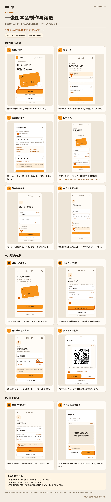
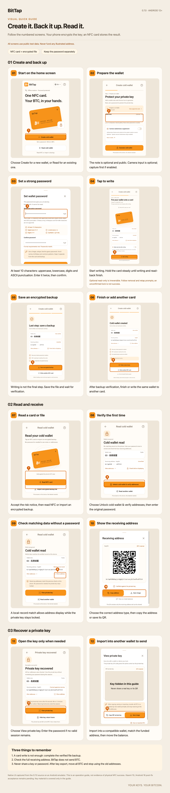

# BitTap 图解使用指南 / Visual usage guides

适用于 **0.7.0 / 内部版本50**。按编号阅读：制作与备份、读取与收款、恢复私钥。点击图片可查看高清原图。

For **0.7.0 / build 50**. Follow the numbered screens to create and back up, read and receive, and recover a private key. Click an image to view it at full size.

[中文指南](#中文指南) · [English guide](#english-guide)

> 图片使用公开测试钱包，**请勿向图中地址转入 BTC**。私钥区域仅在教材中遮挡。这些截图不是实体 NFC 验收或资金安全保证。
>
> Public test-wallet data only. **Never send BTC to the illustrated addresses.** Key material is covered only in the guide. These screenshots do not establish physical NFC acceptance or funds safety.

## 中文指南

[下载中文高清长图](BitTap-Long-Guide-ZH.png)

## English guide

[Download the English full-resolution guide](BitTap-Long-Guide-EN.png)

